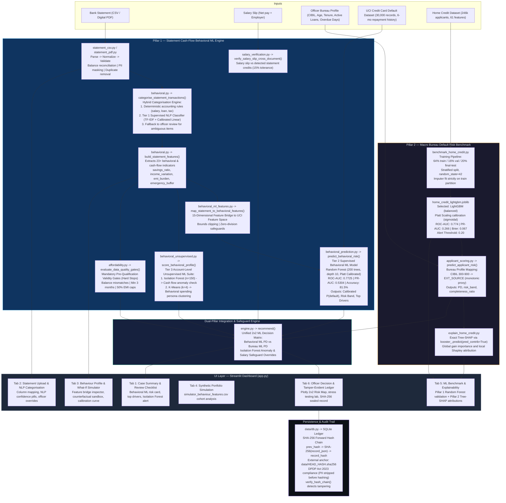
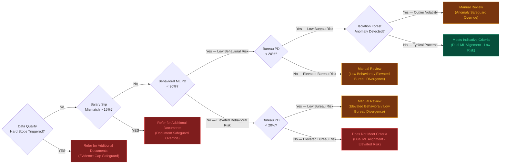

# System Architecture — Behavioral Credit Decision Support System

> **Project**: B.Tech BCSE497J – Project I (VIT)  
> **Team**: Adharsh S (23BDS0029), Gowtham Kumar D (23BDS0186), Rohith S M (23BDS0025)  
> **Faculty Guide**: Dr. Viswanathan A

> [!IMPORTANT]
> The credit decisioning path is driven by **dual machine learning models**:
> 1. **Pillar 1 (Behavioral ML Model)**: Calibrated Random Forest trained on 30,000 real payment records from the UCI Credit Card Default dataset, mapped from bank-statement cash flows.
> 2. **Pillar 2 (Bureau Benchmark Model)**: LightGBM model trained on 246,000 applicants from the Home Credit dataset with Tree-SHAP attribution.
> Rule-based scoring has been completely eliminated from the credit decision path. Data quality hard stops are retained strictly as pre-qualification validity checks.

---

## 1. Full System Architecture (Tri-Tier ML & Deterministic Safeguards)

---

## 2. Dual-Pillar 2x2 Decision Matrix Logic

---

## 3. Module Responsibility Table

| Module | File | Responsibility |
|--------|------|----------------|
| CSV Parser | `src/documents/statement_csv.py` | Multi-format bank CSV parsing with preamble skip, BOM, lakh-commas, Dr/Cr, balance reconciliation, PII masking |
| PDF Parser | `src/documents/statement_pdf.py` | Digital native-text PDF extraction via `pdfplumber`. Fail-closed on scanned/image PDFs |
| Salary Verifier | `src/documents/salary_verification.py` | Cross-document salary vs statement credit comparison; 15% tolerance; flags as officer safeguard |
| Transaction NLP Trainer | `src/models/train_transaction_nlp.py` | Tier 1 Supervised NLP model training; TF-IDF n-grams + Calibrated Linear SGD over 1,025 curated samples across 18 classes |
| Feature Engineer | `src/features/behavioral.py` | Hybrid transaction categorization (exact rules + Calibrated NLP classifier); 23+ behavioral & cash-flow metrics |
| Behavioral ML Bridge | `src/features/behavioral_ml_features.py` | 15-dimensional bridge projecting statement cash-flows into calibrated UCI feature space with clamping and zero-division guards |
| Behavioral ML Trainer | `src/models/train_behavioral_model.py` | Full 70/15/15 train-val-test pipeline on 30k UCI records; 5-fold CV candidate selection; Platt calibration |
| Behavioral ML Predictor | `src/models/behavioral_prediction.py` | Pillar 1 inference module; calibrated P(default), risk bands, permutation feature attributions |
| Behavioral Unsupervised Suite | `src/models/behavioral_unsupervised.py` | Tier 3 Unsupervised ML Suite; Isolation Forest (n=150) anomaly detection and K-Means (k=4) spending persona clustering |
| Quality Gates & Policy | `src/decision/affordability.py` | Pre-qualification data quality hard stops (`evaluate_data_quality_gates`); reference score calculation |
| Decision Engine | `src/decision/engine.py` | Unified Dual-Pillar ML `recommend()` integrating Pillar 1 ML PD, Pillar 2 Bureau PD, and Isolation Forest anomaly overrides |
| Bureau Scorer | `src/models/applicant_scoring.py` | Maps officer-entered bureau profile to Home Credit model features; runs calibrated PD; returns Tree-SHAP |
| SHAP Explainer | `src/models/explain_home_credit.py` | Exact Tree-SHAP via `booster_.predict(pred_contrib=True)`; global gain importance; lru_cache bundle |
| HC Trainer | `src/models/benchmark_home_credit.py` | Full Home Credit training pipeline; stratified 64/16/20 splits; candidate selection; Platt calibration |
| Database | `src/data/db.py` | SQLite with SHA-256 forward hash chain; external anchor; DPDP Act 2023 compliance; tamper detection |
| Matrix Viz | `src/reporting/matrix_viz.py` | Plotly 2x2 decision matrix chart; Tree-SHAP horizontal attribution chart |
| Case Summary | `src/reporting/case_summary.py` | Decision record builder; evidence row aggregation; review flag extractor with ML alerts and anomaly integration |
| App | `app.py` | 6-tab Streamlit UI; FinTech dark CSS; What-If ML sandbox; Plotly reliability curves and population distributions |

---

## 4. Key Performance Numbers (Final-Test — Frozen)

| Metric | Value | Note |
|--------|-------|------|
| **Pillar 1: Behavioral RF ROC-AUC** | **0.7725** | Evaluated on frozen 4,500 held-out UCI test records |
| **Pillar 1: Behavioral RF PR-AUC** | **0.5304** | Lift over 22.1% base rate |
| **Pillar 1: Behavioral Accuracy** | **81.53%** | Calibrated Platt sigmoid probabilities |
| **Pillar 1: F1 (Default Class)** | **0.4842** | Precision 63.31%, Recall 39.20% |
| **Pillar 2: LightGBM ROC-AUC** | **0.774** | 95% CI: 0.767–0.781 (Home Credit benchmark) |
| **Pillar 2: LightGBM PR-AUC** | **0.266** | ~3.3x lift over 8.07% base rate |
| **Pillar 2: Brier Score (calibrated)**| **0.067** | Platt-scaled; trivial predictor ≈ 0.074 |
| **Transaction NLP Accuracy (Tier 1)** | **100%** | 10-fold CV on 1,025 curated samples across 18 classes |
| **Transaction NLP Macro F1 (Tier 1)** | **1.000** | Calibrated Linear SGD + TF-IDF n-grams |
| **Behavioral Clustering (Tier 3)** | **k=4 Personas** | Trained across 2,000 synthetic account profiles |
| **Anomaly Detection (Tier 3)** | **5% Contamination** | Isolation Forest (n=150 estimators) on behavioral cash-flow dimensions |
| **Pytest Automated Tests** | **127 passing** | 0 failures, 100% passing across full test suite |
