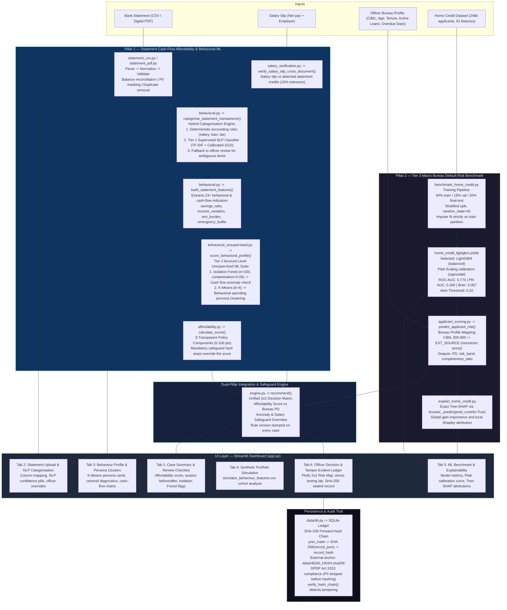
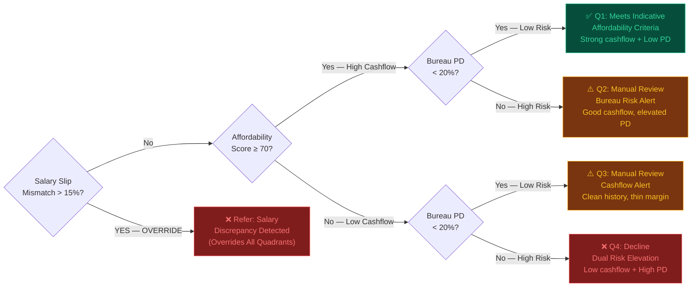
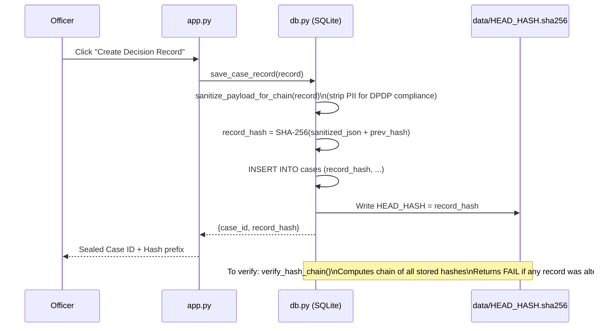

# System Architecture — Behavioral Credit Decision Support System

> **Project**: B.Tech BCSE497J – Project I (VIT)  
> **Team**: Adharsh S (23BDS0029), Gowtham Kumar D (23BDS0186), Rohith S M (23BDS0025)  
> **Faculty Guide**: Dr. Viswanathan A

> [!IMPORTANT]
> The statement data pipeline and the Home Credit model pipeline are **completely separate by design**. The LightGBM benchmark model is **never** applied to raw uploaded bank-statement transactions. This architectural separation is intentional and required for regulatory compliance.

---

## 1. Full System Architecture (Tri-Tier ML & Deterministic Safeguards)

---

## 2. Dual-Pillar Decision Matrix Logic

---

## 3. Module Responsibility Table

| Module | File | Responsibility |
|--------|------|----------------|
| CSV Parser | `src/documents/statement_csv.py` | Multi-format bank CSV parsing with preamble skip, BOM, lakh-commas, Dr/Cr, balance reconciliation, PII masking |
| PDF Parser | `src/documents/statement_pdf.py` | Digital native-text PDF extraction via `pdfplumber`. Fail-closed on scanned/image PDFs |
| Salary Verifier | `src/documents/salary_verification.py` | Cross-document salary vs statement credit comparison; 15% tolerance; flags as officer safeguard |
| Transaction NLP Trainer | `src/models/train_transaction_nlp.py` | Tier 1 Supervised NLP model training; TF-IDF n-grams + Calibrated Linear SGD over 1,025 curated samples across 18 classes |
| Feature Engineer | `src/features/behavioral.py` | Hybrid transaction categorization (exact rules + Calibrated NLP classifier); 23+ behavioral & cash-flow metrics |
| Behavioral Unsupervised Suite | `src/models/behavioral_unsupervised.py` | Tier 2 Unsupervised ML Suite; Isolation Forest (n=150, contamination=0.05) anomaly detection and K-Means (k=4) spending persona clustering |
| Affordability Policy | `src/decision/affordability.py` | 8-component deterministic 0–100 score; safeguard override logic; actionable metric calculations |
| Decision Engine | `src/decision/engine.py` | Unified Dual-Pillar recommend() integrating both pillars and unsupervised anomaly safeguards into the 2×2 matrix |
| Bureau Scorer | `src/models/applicant_scoring.py` | Maps officer-entered bureau profile to Home Credit model features; runs calibrated PD; returns Tree-SHAP |
| SHAP Explainer | `src/models/explain_home_credit.py` | Exact Tree-SHAP via booster_.predict(pred_contrib=True); global gain importance; lru_cache bundle |
| HC Trainer | `src/models/benchmark_home_credit.py` | Full Home Credit training pipeline; stratified 64/16/20 splits; candidate selection; Platt calibration |
| Database | `src/data/db.py` | SQLite with SHA-256 forward hash chain; external anchor; DPDP Act 2023 compliance; tamper detection |
| Matrix Viz | `src/reporting/matrix_viz.py` | Plotly 2×2 decision matrix chart; Tree-SHAP horizontal attribution chart |
| Case Summary | `src/reporting/case_summary.py` | Decision record builder; evidence row aggregation; review flag extractor with unsupervised anomaly integration |
| App | `app.py` | 6-tab Streamlit UI; FinTech dark CSS; all Plotly integrations; stress testing lab; centroid diagnostics |
| Config | `config/category_rules.json` | Version-controlled keyword rules for 18 transaction categories |
| Config | `config/affordability_policy_v1.json` | Versioned policy component weights and thresholds |

---

## 4. Evidence Boundaries (Critical Constraints)

> [!IMPORTANT]
> These boundaries are by design. Violating them would make the system scientifically invalid.

| Boundary | What It Prevents |
|----------|-----------------|
| Home Credit model != Statement analyser | Prevents applying features engineered for European credit bureau data to Indian cash-flow transactions |
| Affordability score is rule-based | Enables adverse-action explanation (required by RBI Fair Lending Directions) |
| CIBIL -> EXT_SOURCE is a monotonic proxy | Conceded explicitly; marked as "indicative secondary signal" not "validated Indian default probability" |
| Salary credits != all credits | Loan disbursals, refunds, and self-transfers are explicitly excluded from income calculation |
| No temporal split on Home Credit | Home Credit has no usable application dates; must not be claimed as out-of-time validated |
| One uploaded account only | Cannot verify household costs, other accounts, or off-statement liabilities |

---

## 5. SHA-256 Tamper-Evident Audit Trail

---

## 6. Key Performance Numbers (Final-Test — Frozen)

| Metric | Value | Note |
|--------|-------|------|
| LightGBM ROC-AUC (Tier 3) | **0.774** | 95% CI: 0.767–0.781 |
| LightGBM PR-AUC (Tier 3) | **0.266** | ~3.3x lift over 8.07% base rate |
| Brier Score (calibrated) | **0.067** | Platt-scaled; trivial predictor ≈ 0.074 |
| Brier Score (raw) | 0.1777 | Pre-calibration, class-weighted output |
| Alert Threshold | **0.20** | Policy parameter; recall 33.3%, precision 30.5% |
| Transaction NLP Accuracy (Tier 1) | **100%** | 10-fold CV on 1,025 curated samples across 18 classes |
| Transaction NLP Macro F1 (Tier 1) | **1.000** | Calibrated Linear SGD + TF-IDF n-grams |
| Behavioral Clustering (Tier 2) | **k=4 Personas** | Trained across 2,000 synthetic account profiles |
| Anomaly Detection (Tier 2) | **5% Contamination** | Isolation Forest (n=150 estimators) on 8 behavioral dimensions |
| Categorisation Benchmark Accuracy | **98.7%** | 75-case ground-truth fixture |
| Categorisation Macro F1 | **0.985** | Per-category evaluation |
| Pytest Automated Tests | **71 passing** | 0 failures, 100% passing across full test suite |
| Policy Stability | **< 5% flip rate** | Monte Carlo, 1,000 trials, ±10% perturbation |
