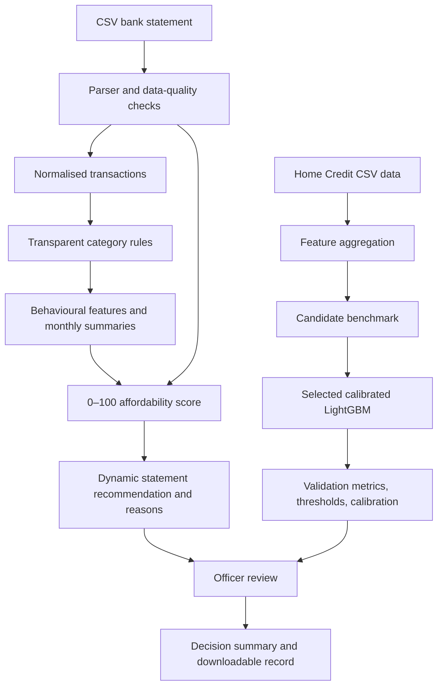

# System architecture

The statement path and the Home Credit model path remain intentionally separate. The system does not apply a model trained on Home Credit fields to raw uploaded bank-statement transactions.
